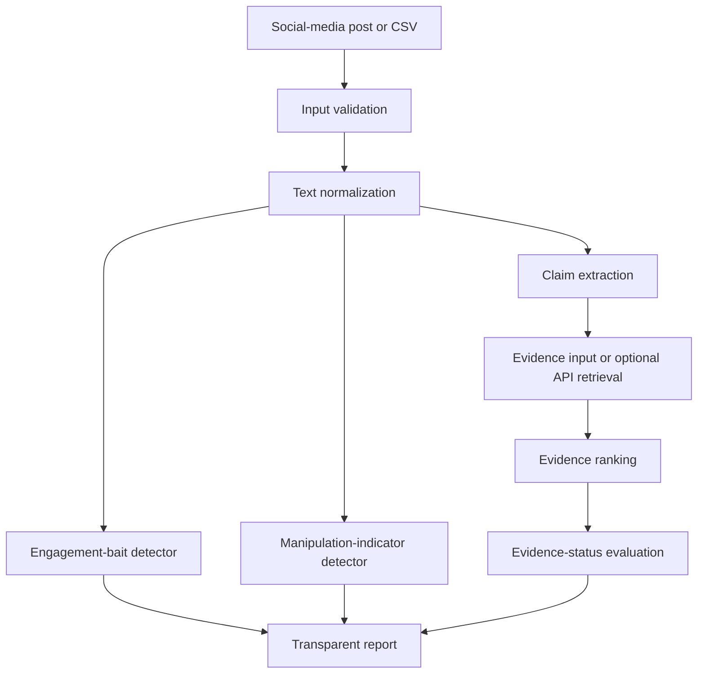
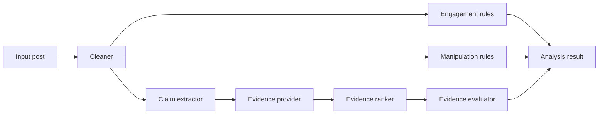

# Detecting Politically Manipulative Engagement Bait and Misleading Narratives

## Advanced Social, Text & Media Analytics (CBS3009)

## Project Report

**Fall Semester 2026-2027**

**Submitted by**

**<<NAME (REGISTRATION NUMBER)>>**

In partial fulfillment for the award of the degree of

**B. Tech in Computer Science and Engineering**

**<<SPECIALIZATION>>**

**School of Computer Science and Engineering**  
**Vellore Institute of Technology**  
Vellore-632014, Tamil Nadu, India

**October 2026**

---

# Contents

1. Project Topic
2. Abstract
3. Introduction
4. Background Study
5. Methodology
6. Proposed Model
7. Results and Discussion
8. Conclusion
9. References

---

# 1. Project Topic

## Detecting Politically Manipulative Engagement Bait and Misleading Narratives in Social Media

This project presents ASTMA, a transparent research prototype for analyzing short social-media posts related to politics, foreign affairs, public policy and global events. The system separates three analytical questions that are often incorrectly combined:

1. Does a post explicitly solicit engagement such as likes, comments, shares, tags or reposts?
2. Does the post contain observable rhetorical indicators associated with manipulation?
3. Does a factual claim have available supporting, contradicting or insufficient evidence?

The central design decision is to keep these outputs independent. A post may be emotionally worded without being false, may request sharing for a legitimate public-safety reason, or may contain a factual claim that cannot be assessed without reliable evidence. ASTMA therefore reports indicators and evidence status rather than declaring political truth or author intent.

---

# 2. Abstract

Political content on social-media platforms frequently combines factual claims with urgency, emotional language and requests for rapid engagement. These features can increase visibility while making careful verification more difficult. This project develops ASTMA, a modular Streamlit application for transparent analysis of short political and foreign-affairs posts. The prototype separates engagement-bait detection, manipulation-indicator analysis and claim-evidence assessment instead of treating them as one misinformation label.

The system uses a rule-based engagement detector to identify explicit requests for sharing, commenting, tagging and reposting, with an exception for public-service messages. A second rule-based module identifies observable patterns including urgency pressure, social pressure, fear appeal, outrage appeal, false dilemma, identity-based pressure and unsupported conspiracy framing. A claim-extraction module identifies sentences containing factual triggers such as official announcements, reports, elections, sanctions and court actions. Evidence status is determined from supplied evidence records, distinguishing support, contradiction, mixed evidence, insufficient evidence and unverified claims. An optional API client and evidence-ranking component provide an extension point for automated retrieval from fact-checking services.

The current prototype contains 22 synthetic sample posts across 15 topics. Of these, 9 are labelled as engagement bait and 13 as non-engagement bait; 21 contain claim-text entries. These figures describe the demonstration data and must not be interpreted as predictive performance. The training metrics artifact reports insufficient data for a stable train/validation/test split, and no trained model binary is currently included. Nevertheless, all 21 automated tests pass, demonstrating that the implemented data validation, ingestion, preprocessing, classification, claim extraction and evidence-status paths operate as intended. The result is a reproducible educational MVP that can be extended with licensed real-world data, human annotation, retrieval evaluation and calibrated machine-learning models.

**Keywords:** social-media analytics, political communication, engagement bait, manipulation indicators, claim verification, evidence ranking, Streamlit, explainable AI.

---

# 3. Introduction

## 3.1 Context

Social-media posts are short, fast-moving and often written for a mixed audience. A single post can contain a factual statement, an interpretation, a call to action and an emotional appeal. This combination creates a practical challenge for analysts: the fact that a message is urgent or highly shareable does not establish that it is false, and a factual error does not necessarily mean that the author intended to manipulate an audience.

A useful analytical system must therefore distinguish content properties that are commonly merged in informal discussions. Engagement solicitation concerns the behaviour requested from readers. Manipulation analysis concerns observable rhetorical patterns. Fact-checking concerns whether a claim is supported by available evidence. Treating these dimensions independently makes the output easier to inspect and reduces the risk of labelling political disagreement, ideology or emotional expression as misinformation.

## 3.2 Problem statement

The project addresses the following problem:

> How can a transparent software system analyze short political social-media posts for engagement solicitation, observable manipulation indicators and claim-evidence status while avoiding unsupported conclusions about political truth, ideology or author intent?

The problem has four technical aspects:

- short and noisy text must be normalized without removing meaningful language;
- multiple rhetorical indicators may occur in the same post;
- factual claims need to be separated from calls to action and opinions;
- evidence retrieval and evidence interpretation must remain distinguishable from the claim itself.

## 3.3 Objectives

The objectives are:

1. To implement a usable Streamlit interface for single-post and batch analysis.
2. To identify explicit engagement requests using explainable rules.
3. To identify common rhetorical pressure patterns without presenting them as proof of intent.
4. To extract claim-like sentences from posts.
5. To classify supplied evidence as supporting, contradicting, mixed, insufficient or unavailable.
6. To validate uploaded datasets before analysis.
7. To provide training and evaluation scripts for future labelled datasets.
8. To document ethical limitations and prevent overclaiming of model performance.

## 3.4 Scope

The Phase 1 prototype focuses on English short-form text. It provides five application pages: a home page, single-post analysis, CSV batch analysis, claim verification, research dashboard and model evaluation. It does not attempt to determine whether a political position is correct, identify malicious users, infer intent, or make publication or moderation decisions automatically.

## 3.5 Contribution

The main contribution is an integrated and inspectable workflow rather than a claim of state-of-the-art classification. Every output can be traced to a rule, an extracted claim, a supplied evidence record or a documented data-validation result. The application also preserves separate labels for engagement bait, manipulation techniques and factual evidence status, which supports more careful research and later model comparison.

---

# 4. Background Study

## 4.1 Fact-checking and claim verification

Fact-checking datasets such as LIAR, FEVER and MultiFC demonstrate that claim verification is an evidence-centered task. A claim cannot be assessed responsibly from wording alone. Verification requires identifying the proposition, locating relevant evidence, evaluating the source and representing uncertainty. FEVER in particular formalized the use of evidence sentences for claims labelled as supported, refuted or not enough information (Thorne et al., 2018).

ASTMA follows the same broad principle at prototype scale. Its claim evaluator does not call every factual-looking sentence true or false. It returns `supported_by_available_evidence`, `contradicted_by_available_evidence`, `mixed_or_context_dependent`, `insufficient_evidence` or `unverified` depending on the evidence records provided. This distinction is especially important for political topics, where evidence may be incomplete, time-dependent or disputed.

## 4.2 Engagement bait and click-oriented language

Engagement-bait analysis is related to, but not identical with, clickbait detection. Clickbait commonly refers to headlines designed to attract attention, while engagement bait explicitly asks users to like, comment, share, tag or repost. A legitimate public-safety message can contain a sharing request without being manipulative. ASTMA consequently uses a separate label and includes a public-service exception for phrases such as official evacuation instructions and public-safety information.

## 4.3 Manipulative rhetoric

Research on propaganda and persuasive communication identifies recurring techniques including fear appeals, bandwagon pressure, name-calling, false dilemmas, conspiracy framing and emotionally loaded language (Miller, 1939; Rashkin et al., 2017). These concepts are useful as descriptive categories, but their presence is not proof of deception. ASTMA reports them as possible indicators and retains a human-review warning.

## 4.4 Explainability and responsible AI

Explainable systems are particularly important when analysing political content. A black-box prediction could obscure whether the system responded to a factual claim, an identity term, a request to share or an irrelevant vocabulary pattern. ASTMA therefore uses explicit indicator lists and returns detected phrases, labels and explanations. The approach is less powerful than a fully trained contextual model, but it is easier to audit and safer for an educational MVP with limited data.

## 4.5 Research gap addressed by the project

Existing claim-verification resources, engagement datasets and propaganda corpora serve different tasks. Combining their labels without care can create invalid training targets. ASTMA addresses this gap by keeping the datasets and outputs conceptually separate. A future study may combine them through a multi-task architecture, but only after ensuring that each label has a clear annotation definition and compatible provenance.

---

# 5. Methodology

## 5.1 System methodology

The system follows this pipeline:



The application exposes the workflow through Streamlit. The Python modules under `src/` contain the reusable logic, while files under `pages/` provide the user interface.

## 5.2 Input data and dataset design

The current demonstration dataset is [data/sample/sample_posts.csv](../data/sample/sample_posts.csv). It uses the following normalized fields:

| Field | Description |
|---|---|
| `post_id` | Unique demonstration identifier |
| `text` | Original short post text |
| `timestamp` | Demonstration timestamp |
| `topic` | Subject category |
| `engagement_bait_label` | Binary engagement-bait label |
| `manipulation_labels` | Semicolon-separated rhetorical labels |
| `claim_text` | Claim-like text associated with the post |
| `claim_verdict` | Demonstration evidence-status label |
| `source_url` | Demonstration source reference |

The current file contains 22 synthetic posts across 15 topics. The engagement labels contain 13 non-bait records and 9 bait records. There are 21 non-empty claim-text entries. The claim-verdict distribution is shown below.

| Demonstration verdict | Count |
|---|---:|
| Unverified | 7 |
| Supported by available evidence | 5 |
| Contradicted by available evidence | 3 |
| Mixed or context-dependent | 3 |
| Not a verifiable factual claim | 2 |
| Insufficient evidence | 2 |

The dataset is intentionally synthetic. Its labels are used to exercise the application and tests; they are not independent external fact-checks and must not be used to claim real-world accuracy.

For real training, the project recommends acquiring licensed or publicly documented sources such as LIAR, FEVER and MultiFC, while maintaining separate provenance and task definitions. Engagement-bait labels should be collected or annotated separately rather than inferred from political truth labels.

## 5.3 Annotation methodology

The intended annotation guide separates four decisions:

1. **Engagement solicitation:** Does the post explicitly request likes, comments, shares, tags or reposts?
2. **Manipulation indicators:** Which observable rhetorical categories appear?
3. **Claim status:** Is there a checkable factual proposition?
4. **Context and uncertainty:** Is there insufficient context or disagreement among sources?

For a real corpus, at least two trained annotators should label each record independently. Disagreements should be retained for review rather than silently forced into one label. An annotation handbook should define edge cases, including public-safety sharing requests, quotations, satire, opinions, predictions, sarcasm and claims that depend on a date or geographic scope.

## 5.4 Preprocessing

The preprocessing module converts missing values to safe text, strips unwanted whitespace and normalizes text for matching. Rule checks operate on cleaned lowercase text. The system avoids aggressive removal of words because terms such as `official`, `reported`, `according to`, `share` and `before they delete` carry analytical meaning.

Dataset validation checks:

- required columns;
- empty datasets;
- blank text rows;
- invalid timestamps;
- duplicate text rows;
- unsupported engagement labels;
- missing manipulation labels.

The validator returns errors, warnings, duplicate counts and class distributions. Errors prevent batch analysis, while warnings are shown to the researcher.

## 5.5 Engagement-bait detection

The engagement detector uses transparent trigger groups:

- share requests: `share this`, `share now`, `please share`, `repost this`;
- comment requests: `comment below`, `drop a comment`;
- tag requests: `tag a friend`, `tag someone`;
- urgency: `urgent`, `right now`, `before they delete`;
- approval pressure: `only real patriots`, `if you care`, `like if you agree`;
- repost pressure: `repost immediately`, `share before`.

If one or more triggers are found, the post is labelled `engagement_bait`, except when a public-service phrase such as `official evacuation`, `official instructions`, `public safety` or `official statement` is present with a sharing request. This exception is deliberately narrow and should be tested further with real data.

## 5.6 Manipulation-indicator detection

The manipulation detector evaluates independent phrase groups:

| Category | Example indicators |
|---|---|
| Urgency pressure | urgent, immediately, right now |
| Social pressure | everyone must, tell everyone, share this |
| Conspiracy framing | elite, cabal, secret plan |
| False dilemma | either, or else, choose one |
| Identity pressure | traitors, cowards, enemy |
| Fear appeal | destroy, collapse, disaster, panic |
| Outrage appeal | shocking, outrageous, disgusting |
| Insufficient context | short catastrophic claims with weak context |

The output contains labels, human-readable indicators, a summary and a rule-based status. The output is not an accusation about the author.

## 5.7 Claim extraction

Claim extraction splits text into sentences and removes obvious calls to action. It retains sentences containing claim-related triggers such as `officials`, `government`, `reported`, `announced`, `according`, `sanctions`, `election`, `minister`, `agency` and `court`. Very short sentences are excluded.

This method is intentionally conservative and imperfect. It can miss claims expressed without trigger words and may retain statements that are reports or opinions. A future implementation should use a trained claim detector or structured semantic parsing, evaluated against human annotations.

## 5.8 Evidence retrieval and fact-checking

The current evidence workflow supports manual records and an optional API client. A normalized evidence item may include:

- title;
- URL;
- snippet;
- source type;
- publication date;
- support or contradiction label;
- relevance score;
- notes.

The optional `FactCheckClient` reads `FACTCHECK_API_KEY` and `FACTCHECK_API_URL` from the environment. If credentials are absent, it returns no evidence rather than inventing a result. The evidence-ranking module increases relevance for exact claim matches, official or fact-check language and explicit support/contradiction labels. The evaluator then aggregates the evidence labels.

The intended real-world workflow is:

1. Extract the claim.
2. Query a fact-checking service or search an approved source collection.
3. Normalize returned records.
4. Rank by claim relevance and source quality.
5. Compare supporting and contradicting records.
6. Return uncertainty when the evidence is mixed or absent.
7. Present sources to a human reviewer.

At present, the Streamlit claim-verification page accepts manual evidence JSON. The main post-analysis path passes an empty evidence list, so its extracted claims are reported as unverified. This behaviour is appropriate for the current offline MVP and should be changed only after API responses, source quality and failure handling are tested.

## 5.9 Training methodology

The repository includes a future training path using TF-IDF features with Logistic Regression and Linear SVM classifiers. The training module requires text, binary engagement labels and at least two classes. It uses a stratified train/test split with a fixed random seed and saves joblib artifacts to the models directory.

However, the current demonstration dataset is too small for a stable train/validation/test experiment. The metrics file therefore records `insufficient_data`, and no trained `.joblib` artifact is included. Live application results currently come from the rule-based detector.

---

# 6. Proposed Model

## 6.1 Architecture

ASTMA is a modular multi-stage architecture rather than one monolithic classifier.



## 6.2 Application components

### Home page

The home page loads the sample dataset and displays row count, engagement-bait examples and model status. It explains the separation between engagement, manipulation and factual evidence.

### Single Post Analyzer

The user enters post text, an optional source URL and an optional topic. The page calls `analyze_post`, displays engagement and manipulation assessments, lists extracted claims and shows evidence status.

### Batch Analysis

The user uploads a CSV. The page validates required fields, analyzes each non-empty text row and creates a downloadable CSV containing predicted engagement label, detected indicators, manipulation labels and claim count.

### Claim Verification

The user enters a claim and evidence records as JSON. The page parses the records and calls the evidence evaluator. Invalid JSON results in an empty evidence set and an explanatory warning.

### Research Dashboard

The dashboard shows engagement-label counts, topic distribution, common n-grams and phrase patterns grouped by label. The dashboard warns that associative patterns do not prove deception or intent.

### Model Evaluation

The evaluation page reads saved metrics, displays dataset summary and compares validation and held-out metrics when trained artifacts exist. The current metrics state explains that the sample is insufficient for stable evaluation.

## 6.3 Representative source code

The following simplified logic illustrates the engagement decision used by the prototype:

```python
indicators = detector._detect_indicators(clean_text)

safe_public_service = (
    "official evacuation" in clean_text
    or "official instructions" in clean_text
    or "public safety" in clean_text
    or "official statement" in clean_text
) and "share" in clean_text

if indicators and not safe_public_service:
    label = "engagement_bait"
else:
    label = "not_engagement_bait"
```

The evidence-status aggregation follows the principle that support and contradiction should not be collapsed:

```python
if support_count > 0 and contradict_count == 0:
    status = "supported_by_available_evidence"
elif contradict_count > 0 and support_count == 0:
    status = "contradicted_by_available_evidence"
elif support_count > 0 and contradict_count > 0:
    status = "mixed_or_context_dependent"
else:
    status = "insufficient_evidence"
```

## 6.4 Design rationale

The architecture prioritizes:

- **Transparency:** each label has an observable rule or evidence source;
- **Modularity:** each component can be replaced independently;
- **Uncertainty:** absent evidence is not treated as contradiction;
- **Safety:** rhetoric is not treated as proof of intent;
- **Reproducibility:** fixed schemas, scripts and tests support repeatable experiments.

## 6.5 Proposed future model

With a sufficiently large, licensed and independently annotated corpus, the next version could use a multi-task model with shared text representations and separate output heads for engagement bait, manipulation techniques, claim detection and evidence stance. A retrieval-augmented verifier could rank source passages before a stance classifier. Such a model should be compared against the current rules and TF-IDF baselines, calibrated for uncertainty and evaluated separately by task.

---

# 7. Results and Discussion

## 7.1 Implementation results

The current implementation provides:

| Component | Status |
|---|---|
| Streamlit application | Implemented |
| Single-post analysis | Implemented |
| Batch CSV analysis | Implemented |
| Dataset validation | Implemented |
| Engagement-bait heuristic | Implemented |
| Manipulation-indicator heuristic | Implemented |
| Claim extraction | Implemented |
| Manual evidence evaluation | Implemented |
| Optional fact-check API client | Extension implemented, disabled without credentials |
| Evidence ranking | Implemented as baseline |
| TF-IDF model training | Implemented for future adequate data |
| Stable trained model artifact | Not available with current sample |

## 7.2 Demonstration dataset results

The synthetic sample contains 22 records. The class distribution is not an evaluation result.

| Measure | Value |
|---|---:|
| Total posts | 22 |
| Topics | 15 |
| Engagement-bait posts | 9 |
| Non-engagement-bait posts | 13 |
| Posts with claim text | 21 |
| Duplicate text rows | 0 |

The validator reports no errors. It reports warnings for missing manipulation labels in rows where the field is empty. This is a useful distinction: the sample is structurally usable for the application, but not complete enough to support broad claims about manipulation-label coverage or model generalization.

## 7.3 Evidence-status distribution

The claim-verdict values embedded in the demonstration data are:

| Status | Count | Interpretation |
|---|---:|---|
| Unverified | 7 | No verified evidence represented in the demo record |
| Supported | 5 | Demo record indicates available supporting evidence |
| Contradicted | 3 | Demo record indicates available contradicting evidence |
| Mixed | 3 | Demo record indicates disagreement or contextual dependence |
| Not verifiable | 2 | Text is a call to action or not a factual claim |
| Insufficient evidence | 2 | Available information is too weak to decide |

These labels demonstrate the output vocabulary and should not be interpreted as external fact-check results. In the live offline post-analysis path, claims are conservatively returned as unverified because no evidence is automatically supplied.

## 7.4 Automated test results

The project contains nine test modules and currently passes 21 tests.

| Test area | Result |
|---|---|
| Application logic | Passed |
| Claim extraction and evidence evaluation | Passed |
| Dataset validation | Passed |
| Engagement classifier | Passed |
| Data ingestion | Passed |
| Linguistic analysis | Passed |
| Manipulation classifier | Passed |
| N-gram extraction | Passed |
| Text preprocessing | Passed |
| **Total** | **21 passed** |

The test suite verifies expected behaviour for empty input, evidence support, no evidence, label validation, ingestion, rhetorical indicators and preprocessing. It is a software correctness check, not a measure of real-world classification accuracy.

## 7.5 Sample application outputs

The final formatted report should include screenshots of the following modules after launching the application with `streamlit run app.py`:

1. Home page showing dataset status.
2. Single Post Analyzer showing engagement, manipulation and claim sections.
3. Batch Analysis showing validation and downloadable results.
4. Claim Verification showing a manually supplied supporting evidence record.
5. Research Dashboard showing topic and phrase-pattern charts.
6. Model Evaluation showing the current insufficient-data message.

Suggested demonstration inputs include:

- `Share this now! Officials announced a new trade restriction yesterday.`
- `Only traitors will refuse to repost this. The hidden elite are planning a takeover.`
- `The ministry published the new tariff schedule on its website yesterday.`

Screenshots should be captured from the running local application and inserted below the relevant subsection in the final Word document. The synthetic sources and outputs should be visibly described as demonstration material.

## 7.6 Error analysis

The rule-based system has predictable failure modes:

- A legitimate message may contain a sharing request and be flagged if it does not match the narrow public-service exception.
- A post may use new wording not covered by the trigger lists.
- A quoted claim may be interpreted as the author’s own claim.
- A factual claim without one of the trigger terms may be missed.
- A claim can be correctly extracted but remain unverified when evidence retrieval is unavailable.
- Exact string matching can fail when spelling, punctuation, morphology or language changes.
- The detector does not understand chronology, negation, sarcasm or source reliability deeply.

These errors motivate future annotation, multilingual preprocessing, semantic retrieval and human review.

## 7.7 Discussion

The strongest current result is not a numerical accuracy score but a working, inspectable research workflow. The application can load data, validate it, analyze posts, separate output dimensions and display uncertainty. The system also makes an important methodological distinction: a post can be labelled as containing social pressure while its factual claim remains unverified, or it can contain a legitimate request to share an official safety instruction without being treated as engagement bait.

The main limitation is data. Twenty-two synthetic examples are enough for a demonstration and regression tests but not for training a reliable political-content classifier. The metrics artifact correctly records insufficient data. Any future report claiming accuracy, precision, recall or F1 must be based on a larger independently annotated test set and must report class balance, split strategy, confidence intervals and error categories.

---

# 8. Conclusion

This project developed ASTMA, a transparent Streamlit prototype for analysing politically relevant social-media posts. The system separates engagement bait, manipulation indicators and factual evidence status so that each output can be reviewed independently. It includes a single-post analyzer, CSV batch workflow, claim-verification page, research dashboard, model-evaluation page, validation utilities, training scripts and automated tests.

The current implementation is a rule-based MVP supported by a synthetic dataset. It successfully demonstrates the intended software architecture and passes all 21 automated tests. Its claim-verification component supports evidence-aware statuses and optional retrieval integration, but automatic external fact-checking is not enabled by default. The project does not currently contain a validated trained model, and the sample is too small for meaningful generalization claims.

The most important conclusion is that transparent separation is preferable to a single unsupported label. Engagement solicitation, rhetorical pressure and evidence status are related but distinct properties. Preserving that distinction supports more responsible research, clearer debugging and safer future expansion.

## Future work

1. Acquire licensed, larger and more diverse datasets.
2. Create a two-annotator guide and measure inter-annotator agreement.
3. Connect the optional fact-check client to a documented provider.
4. Add source-quality and publication-date ranking.
5. Add API-response normalization and retrieval failure tests.
6. Integrate evidence retrieval into the post-analysis path only after validation.
7. Train and compare calibrated TF-IDF, transformer and retrieval-augmented baselines.
8. Add multilingual and cross-platform support.
9. Evaluate subgroup, topic and temporal performance.
10. Add audit logs and explicit human-review workflows.

---

# 9. References

All references below should be checked against the exact edition or URL accessed before final submission. They are listed in Harvard-style author order.

Baly, R., Karadzhov, G., Alexandrov, D., Glass, J. and Nakov, P. (2018) ‘Predicting factuality of reporting and bias of news media sources’, *Proceedings of the 2018 Conference on Empirical Methods in Natural Language Processing*, pp. 3528–3539.

FEVER (2026) *FEVER: A large-scale dataset for Fact Extraction and VERification*. Available at: https://fever.ai/dataset/fever.html (Accessed: 26 October 2026).

Miller, W. (1939) ‘The fringe of the political spectrum’, *American Journal of Sociology*, 45(2), pp. 295–302.

Pennebaker, J.W., Booth, R.J., Boyd, R.L. and Francis, M.E. (2022) *Linguistic Inquiry and Word Count: LIWC-22*. Austin, TX: Pennebaker Conglomerates.

Rashkin, H., Choi, E., Jang, J.Y., Volkova, S. and Choi, Y. (2017) ‘Truth of varying shades: Analyzing language in fake news and political fact-checking’, *Proceedings of the 2017 Conference on Empirical Methods in Natural Language Processing*, pp. 2931–2940.

Thorne, J., Vlachos, A., Christodoulopoulos, C. and Mittal, A. (2018) ‘FEVER: A large-scale dataset for Fact Extraction and VERification’, *Proceedings of the 2018 Conference of the North American Chapter of the Association for Computational Linguistics: Human Language Technologies*, pp. 809–819.

Wang, W.Y. (2017) ‘“Liar, liar pants on fire”: A new benchmark dataset for fake news detection’, *Proceedings of the 55th Annual Meeting of the Association for Computational Linguistics*, pp. 422–426.

Zubiaga, A., Aker, A., Bontcheva, K., Liakata, M. and Procter, R. (2018) ‘Detection and resolution of rumours in social media: A survey’, *ACM Computing Surveys*, 51(2), Article 32.

---

# Appendix A: Project structure

```text
app.py                         Streamlit entry point
pages/                         Streamlit application pages
src/data/                      Loading, ingestion, validation and preprocessing
src/features/                 N-gram feature extraction
src/models/                   Heuristic and future ML model code
src/verification/              Claims, evidence ranking and API client
scripts/                       Validation, training and evaluation commands
data/sample/                  Synthetic demonstration data
models/                       Metrics and future model artifacts
tests/                        Automated tests
reports/                      Methodology and project-report documents
```

# Appendix B: Reproduction commands

```powershell
cd C:\Users\Lakshmi\ASTMA
.\.venv\Scripts\Activate.ps1
python -m pip install -r requirements.txt
python scripts/validate_dataset.py --input data/sample/sample_posts.csv
python -m pytest -q
streamlit run app.py
```

# Appendix C: Important limitations statement

ASTMA is a research and educational prototype. Its synthetic sample is not a representative social-media corpus. Its rhetorical labels are indicators rather than proof of manipulation or intent. Its evidence statuses are only as reliable as the evidence records and source quality supplied to the system. The application must not be used to target individuals, nationalities or political groups, or to make unsupported moderation, employment, legal or publication decisions.
